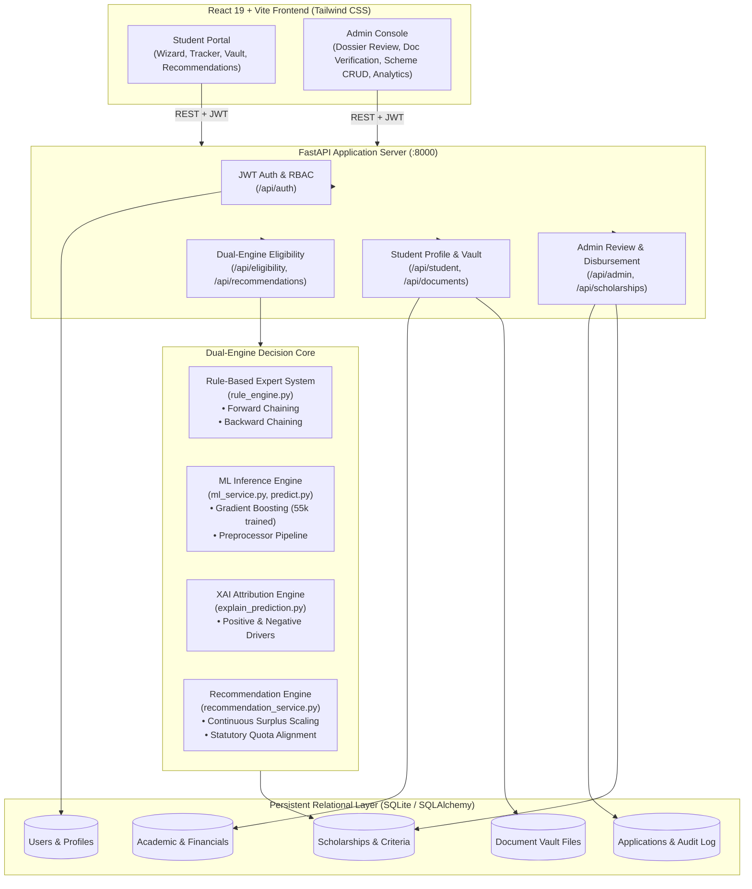

# ScholarAI: Scholarship Eligibility Expert System

> **Full-Stack Academic Decision Support System** combining a **Deterministic Rule-Based Expert System (Forward & Backward Chaining)**, a **Gradient Boosting Machine Learning Classifier (55,000+ Dataset)**, an **Explainable AI (XAI) Attribution Engine**, and an **End-to-End Administrative Review & Disbursement Workflow**.

---

## 📑 Table of Contents
1. [Project Overview](#-project-overview)
2. [System Architecture](#-system-architecture)
3. [Key Implemented Features](#-key-implemented-features)
4. [Machine Learning Pipeline](#-machine-learning-pipeline)
5. [Expert System: Experiment 9 (Forward & Backward Chaining)](#-expert-system-experiment-9-forward--backward-chaining)
6. [Scholarship Recommendation & Match Scoring Engine](#-scholarship-recommendation--match-scoring-engine)
7. [Repository Structure](#-repository-structure)
8. [API Route Specifications](#-api-route-specifications)
9. [Installation & Local Run Guide](#-installation--local-run-guide)
10. [Default Demo Accounts](#-default-demo-accounts)
11. [Verification & Test Suite](#-verification--test-suite)
12. [Security, Fairness & Data Integrity Safeguards](#-security-fairness--data-integrity-safeguards)
13. [Academic Transparency & System Limitations](#-academic-transparency--system-limitations)

---

## 🌟 Project Overview

ScholarAI addresses the transparency and access barriers in higher education funding. Rather than treating scholarship allocation as a black-box problem or relying solely on rigid database filters, ScholarAI implements a **dual-engine decision support architecture**:

1. **Deterministic Rule-Based Expert System (Symbolic AI):** Evaluates non-negotiable statutory and institutional criteria (minimum CGPA, annual income ceilings, active backlogs, minimum attendance) using classical **Forward Chaining** (data-driven deduction) and **Backward Chaining** (goal-driven proof trees).
2. **Gradient Boosting Machine Learning Model (Empirical AI):** Evaluates multidimensional peer competitiveness trained across 55,000 realistic student profiles over 23 raw features, 4 engineered indices, and 74 one-hot encoded features.
3. **Hybrid Eligibility & Explainable AI (XAI):** Synthesizes deterministic rules and statistical probabilities into an integrated eligibility verdict, supplemented by human-readable positive drivers, negative factors, and actionable improvement guidance.
4. **Recommendation & Administrative Lifecycle:** Ranks active schemes with differentiated, continuous match scores ($0.0 - 100.0\%$), and provides end-to-end applicant tracking, Document Vault verification, and committee approval/disbursement workflows.

---

## 🏛️ System Architecture



---

## 🚀 Key Implemented Features

### 1. Student Portal & Guided Onboarding
- **Zero-Drop Onboarding Wizard:** First-time registered students are flagged with `profile_is_complete=False` and guided through a multi-step onboarding wizard covering personal demographics, academic metrics, household financials, and achievements.
- **Persistent Profile Reuse:** Returning students access their profile directly; profile updates re-evaluate eligibility without deleting historical assessment records.
- **Document Vault:** Secure upload and storage of identity proofs, marksheets, income certificates, and caste certificates in `backend/uploads/`.
- **Live Application Tracking:** Real-time visibility into application lifecycle stages (`PENDING`, `UNDER_REVIEW`, `NEEDS_INFORMATION`, `APPROVED`, `REJECTED`, `AWARDED`, `DISBURSED`).

### 2. Dual-Engine Eligibility Assessment
- **Category-Independent General Assessment:** General institutional eligibility evaluates purely academic merit, income need, backlogs, and attendance without requiring or factoring in caste/category.
- **Explainable AI (XAI):** Generates transparent explanations:
  - *Positive Drivers:* e.g., "Exemplary academic continuity (0 backlogs)", "High attendance regularity (89.0%)".
  - *Negative Factors / Actionable Guidance:* e.g., "Annual income approaches scheme boundary", "Clear active backlogs to unlock higher-tier scholarships".

### 3. Transparent Recommendation Scoring
- **Continuous Score Differentiation:** Replaces static score clamping with dynamic surplus headroom scaling, ensuring students who exceed minimum criteria receive meaningful score differentiation.
- **Distinction Between Eligibility and Match:** Clearly separates a numerical affinity score from mandatory statutory eligibility. Missing requirements incur structured penalties and cap match scores below qualified thresholds ($\le 75.0\%$).

### 4. Administrative Oversight & Committee Workflow
- **Application Dossier Review:** Complete breakdown of applicant academics, financials, uploaded certificates, and criteria fulfillment.
- **Document Verification Workflow:** Admin marks individual certificates as `PENDING`, `VERIFIED`, or `REJECTED`.
- **Information Requests:** Committee can transition applications to `NEEDS_INFORMATION` with mandatory remarks visible to the student.
- **Genuine Award & Disbursement Tracking:** Records official scholarship awards and disbursement references (e.g. `PFMS-DBT-2026-NSP89412`) separate from initial approval.
- **Scheme CRUD & Criteria Builder:** Administrators can create, update, or deactivate scholarship schemes and configure custom criteria.
- **Live Model Performance & Retraining:** Inspect live confusion matrices, benchmark metrics, and trigger asynchronous retraining from the web UI.

---

## 🤖 Machine Learning Pipeline

### 1. Dataset Generation & Fairness By Design
- **Source:** Generated via `ml/data/generate_dataset.py` with realistic statistical correlations derived from Indian higher education demographic patterns (AISHE census distributions).
- **Dataset Size:** Exactly **55,000 student records** saved in `ml/data/scholarship_dataset.csv`.
- **Category Exclusion:** The `category` (caste) column is strictly **excluded** from all training features, target definitions, and model artifacts to guarantee demographic neutrality.

### 2. Feature Schema & Engineering
- **Raw Features (23 Columns):**
  - *Categorical (10):* `gender`, `state`, `rural_urban`, `education_level`, `course`, `institution_type`, `parent_occupation`, `financial_dependency`, `sports_achievement`, `academic_achievement`.
  - *Numerical (13):* `age`, `disability`, `first_generation`, `year`, `cgpa`, `percentage`, `backlogs`, `attendance`, `family_income`, `family_size`, `earning_members`, `extracurricular_score`, `previous_scholarship`.
- **Engineered Indices (`ml/feature_engineering.py`):**
  1. $\text{Income Per Capita} = \frac{\text{family\_income}}{\max(\text{family\_size}, 1)}$
  2. $\text{CGPA to Percentage Ratio} = \frac{\text{percentage}}{\max(\text{cgpa} \times 9.5, 1.0)}$
  3. $\text{Dependency Ratio} = \frac{\text{family\_size}}{\max(\text{earning\_members}, 1)}$
  4. $\text{Academic Consistency} = \left(\frac{\text{cgpa}}{10.0}\right) \times \left(\frac{\text{attendance}}{100.0}\right)$
- **Encoded Features:** Scikit-Learn `ColumnTransformer` (One-Hot Encoding + Standard Scaling) produces **74 numerical input features** (`ml/models/feature_names.pkl`).

### 3. Model Benchmark & Active Classifier
Trained and serialized using `ml/train_models.py` on an 80/20 stratified split (44,000 train / 11,000 test) with 5-fold cross-validation. The metrics below reflect the active evaluation recorded in `ml/models/model_metrics.json`:

| Model | Accuracy | Precision | Recall | F1 Score | ROC-AUC | 5-Fold CV F1 |
| :--- | :---: | :---: | :---: | :---: | :---: | :---: |
| **Logistic Regression** | 92.45% | 96.52% | 92.35% | 0.9439 | 0.9807 | $0.9419 \pm 0.0044$ |
| **Decision Tree** | 93.93% | 97.36% | 93.71% | 0.9550 | 0.9810 | $0.9504 \pm 0.0020$ |
| **Random Forest** | 93.96% | 98.20% | 92.93% | 0.9549 | 0.9879 | $0.9520 \pm 0.0033$ |
| **Gradient Boosting (Active)** | **95.08%** | **97.82%** | **94.96%** | **0.9637** | **0.9922** | **$0.9614 \pm 0.0024$** |

> [!NOTE]
> The active model serialized in `ml/models/gradient_boosting_model.pkl` is consumed at runtime by `backend/app/services/ml_service.py` and `ml/predict.py`. Top feature importances: `backlogs` (35.8%), `family_income` (23.6%), and `cgpa` (16.4%).

---

## 🧠 Expert System: Experiment 9 (Forward & Backward Chaining)

The deterministic reasoning core is implemented in [backend/app/services/rule_engine.py](file:///c:/Users/Rohan/Desktop/devagini/AI_mini_project_new/backend/app/services/rule_engine.py) to fulfill the requirements of **Academic Semester AI Experiment 9: Rule-Based Expert Systems**.

### 1. Core Classes & Knowledge Base
- `Fact`: Represents verified ground facts (source: `INPUT`), derived facts (source: `INFERRED`), or hypotheses with states `TRUE`, `FALSE`, or `UNKNOWN`.
- `Rule`: Horn clause representing $\bigwedge \text{Antecedents} \implies \text{Consequent}$.
- Knowledge Base Rules (`build_scholarship_knowledge_base()`):
  - `R1_ACAD_MERIT`: `academic_merit_passed` (CGPA $\ge 6.0$) $\implies$ `academic_criteria_satisfied`
  - `R2_FIN_NEED`: `income_need_passed` (Income $\le$ ₹8,00,000) $\implies$ `financial_criteria_satisfied`
  - `R3_FIN_EXEMPT`: `income_exempt_applied` (Merit exemption: CGPA $\ge 8.5$) $\implies$ `financial_criteria_satisfied`
  - `R4_BACKLOG_CLEAN`: `backlog_norm_passed` (0 backlogs) $\implies$ `continuity_criteria_satisfied`
  - `R5_BACKLOG_COND`: `backlog_marginal_passed` (1 backlog) $\implies$ `continuity_conditional_satisfied`
  - `R6_ATTENDANCE_FULL`: `attendance_regularity_passed` (Attendance $\ge 75\%$) $\implies$ `attendance_criteria_satisfied`
  - `R7_ATTENDANCE_COND`: `attendance_borderline_passed` (Attendance $65\%-74.9\%$) $\implies$ `attendance_conditional_satisfied`
  - `R8_FULL_ELIGIBILITY`: Academic $\land$ Financial $\land$ Continuity $\land$ Attendance $\implies$ `generally_eligible`
  - `R9_COND_ELIGIBILITY`: Academic $\land$ Financial $\implies$ `conditionally_eligible`

### 2. Forward Chaining Engine (`ForwardChainingEngine.infer`)
- **Methodology (Data-Driven Reasoning):** Starts with verified student input facts (`cgpa`, `family_income`, `backlogs`, `attendance`).
- **Execution:** Iteratively scans the rule set, detects satisfied Horn clauses, fires eligible rules, and accumulates newly derived facts into working memory until reaching a fixed point.
- **Trace Output:** Generates a structured derivation trace detailing the exact iteration, fired rule ID, and triggering antecedents.

### 3. Backward Chaining Engine (`BackwardChainingEngine.prove_goal`)
- **Methodology (Goal-Driven Reasoning):** Begins with an explicit objective (e.g., `goal = "generally_eligible"`).
- **Execution:** Performs recursive depth-first search for candidate rules concluding the target goal. For each rule, it recursively verifies whether all antecedents are satisfied by ground facts or derivable through sub-proofs.
- **Safeguards:** Features cycle detection (`visited` set) and distinguishes `UNKNOWN` facts (missing profile sections) from `FALSE` facts (disqualified criteria).

---

## 🎯 Scholarship Recommendation & Match Scoring Engine

Implemented in [backend/app/services/recommendation_service.py](file:///c:/Users/Rohan/Desktop/devagini/AI_mini_project_new/backend/app/services/recommendation_service.py). Match scores reflect scheme affinity and are bounded within $[0.0, 100.0]\%$.

### 1. Sub-Score Weighting Matrix
$$\text{Total Raw Match} = \text{Score}_{\text{ML}} + \text{Score}_{\text{Academic}} + \text{Score}_{\text{Financial}} + \text{Score}_{\text{Statutory}}$$

| Component | Weight | Mathematical Function | Description |
| :--- | :---: | :--- | :--- |
| **ML Readiness** | **35%** | $\text{ml\_prob} \times 35.0$ | Continuous peer competitiveness over 24 trained features. |
| **Academic Fit** | **35%** | • $\text{CGPA} \ge \text{min}: 20.0 + \left(\frac{\text{CGPA} - \text{min}}{10.0 - \text{min}}\right) \times 15.0$<br/>• $\text{CGPA} < \text{min}: \max\left(0, 20.0 - \left[\frac{\text{min} - \text{CGPA}}{\text{min}}\right] \times 40\right)$ | Continuous surplus scaling above published minimum threshold up to 10.0 CGPA; proportional deficit reduction below threshold. |
| **Financial Need** | **20%** | • $\text{Need Ratio} = \frac{\text{max\_income} - \text{income}}{\text{max\_income}}$<br/>• Merit Scheme: $15.0 + (\text{Need Ratio} \times 5.0)$<br/>• Need Scheme: $10.0 + (\text{Need Ratio} \times 10.0)$<br/>• Excess Income: $\max(0, 10.0 - [\text{Excess Ratio} \times 25])$ | Differentiates schemes based on published income limits and stated scheme purpose (Merit vs Need-Based). |
| **Statutory / Quota** | **10%** | • General (`All`): $10.0\text{ pts}$ (Zero Caste Bias)<br/>• Reserved: $10.0$ if category matched; $5.0$ if unspecified (provisional); $0.0$ if mismatched<br/>• Female / PwD: $10.0$ if matched, $0.0$ otherwise | Strict equality for general schemes; statutory criteria enforced only where legally mandated. |

### 2. Penalty & Eligibility Distinction
$$\text{Final Match } \% = \begin{cases} \min(\max(\text{Total Raw Match}, 0.0), 100.0) & \text{if } |\text{Missing}| = 0 \\ \max(\min(\text{Total Raw Match} - [|\text{Missing}| \times 15.0], 75.0), 10.0) & \text{if } |\text{Missing}| > 0 \end{cases}$$

### 3. Terminology Distinction Guide
- **Scholarship Match Percentage:** A heuristic multidimensional alignment score ($0.0 - 100.0\%$). It is **NOT** a probability or guarantee of receiving funds.
- **General AI Eligibility:** Baseline institutional qualification (`ELIGIBLE`, `CONDITIONALLY_ELIGIBLE`, `NOT_ELIGIBLE`) evaluated by the dual engine.
- **Scholarship-Specific Eligibility:** Deterministic verification against a specific scheme's legal constraints (`min_cgpa`, `max_income`, `required_category`, `required_courses`).
- **Administrative Decision:** Human committee decision (`APPROVED`, `REJECTED`, `NEEDS_INFORMATION`) based on physical document verification.
- **Disbursement:** The official financial disbursement record referencing external remittance (e.g. PFMS reference number).

---

## 📁 Repository Structure

```
AI_mini_project_new/
├── backend/
│   ├── app/
│   │   ├── auth/              # Password hashing (bcrypt) & JWT token handling
│   │   ├── database/          # SQLAlchemy connection & normalized ORM models
│   │   ├── routes/            # FastAPI API route modules (8 route groups)
│   │   ├── schemas/           # Pydantic request/response validation schemas
│   │   ├── services/          # Rule Engine, ML Service, XAI, Recommendation Engine
│   │   ├── config.py          # App settings, CORS, and upload paths
│   │   └── main.py            # FastAPI entrypoint, router binding & startup seed
│   ├── requirements.txt       # Python dependencies
│   └── uploads/               # Local Document Vault storage
├── frontend/
│   ├── src/
│   │   ├── components/        # Navbar, Sidebar, Modals, MetricCards, ErrorBoundary
│   │   ├── context/           # AuthContext (JWT session state & role guards)
│   │   ├── pages/             # All 18 React application pages
│   │   ├── services/          # Axios API client (api.js) with interceptors
│   │   ├── App.jsx            # React Router v7 routes & layout wrappers
│   │   └── index.css          # Tailwind CSS styles & typography tokens
│   ├── package.json           # Frontend dependencies (React 19, Vite, Lucide, Recharts)
│   └── vite.config.js         # Vite build configuration
├── ml/
│   ├── data/
│   │   ├── generate_dataset.py       # 55,000 synthetic profile generator
│   │   └── scholarship_dataset.csv   # Pre-generated 55k dataset (no category column)
│   ├── models/
│   │   ├── gradient_boosting_model.pkl # Serialized active classifier
│   │   ├── preprocessor.pkl            # Serialized feature transformer pipeline
│   │   ├── feature_names.pkl           # 74 processed feature names
│   │   └── model_metrics.json          # Benchmark evaluation metrics
│   ├── data_preprocessing.py # Preprocessing & column transformer pipeline
│   ├── feature_engineering.py # Categorical/numerical definitions & 4 derived indices
│   ├── train_models.py        # 4-model benchmark & cross-validation trainer
│   ├── predict.py             # Inference class for runtime predictions
│   └── explain_prediction.py  # XAI factor decomposition engine
├── tests/                     # Automated test suites
│   ├── test_admin_application_review_workflow.py
│   ├── test_caste_independent_eligibility.py
│   ├── test_onboarding_and_profile_flow.py
│   ├── test_recommendation_match_calculation.py
│   ├── test_recommendations_application_status_sync.py
│   ├── test_review_security_and_resilience.py
│   └── test_statutory_flow.py
├── test_api.py                # End-to-end API smoke test suite
├── scholarship_system.db      # SQLite database
├── start_servers.bat          # 1-click launcher for Windows CMD
└── start_servers.ps1          # 1-click launcher for PowerShell
```

---

## 🔌 API Route Specifications

| Route Prefix | Router Module | Primary Endpoints | Access Control |
| :--- | :--- | :--- | :--- |
| `/api/auth` | `auth_routes.py` | `POST /register`, `POST /login`, `GET /me` | Public / Authenticated |
| `/api/student` | `student_routes.py` | `GET /profile`, `PUT /profile`, `GET /dashboard` | Student Only |
| `/api/eligibility` | `eligibility_routes.py` | `POST /verify`, `GET /latest`, `GET /history` | Student / Admin |
| `/api/recommendations` | `eligibility_routes.py` | `GET /` | Student Only |
| `/api/applications` | `application_routes.py` | `POST /`, `GET /`, `GET /{id}` | Student / Admin |
| `/api/documents` | `document_routes.py` | `POST /upload`, `GET /`, `GET /{id}/download` | Student (Owner) / Admin |
| `/api/scholarships` | `scholarship_routes.py` | `GET /`, `GET /{id}`, `POST /`, `PUT /{id}`, `DELETE /{id}` | Public (Read) / Admin (CRUD) |
| `/api/admin` | `admin_routes.py` | `GET /dashboard`, `GET /applications`, `GET /applications/{id}`, `PUT /applications/{id}/review`, `PUT /documents/{id}/verify`, `GET /ml-metrics`, `POST /retrain` | Admin Only (`require_role(["ADMIN"])`) |

---

## 🛠️ Installation & Local Run Guide

### 1. Prerequisites
- **Python:** 3.10 to 3.14 (Python 3.14 tested)
- **Node.js:** v18.0.0 or later (Node v24.18.0 / npm 11.16.0 tested)
- **Operating System:** Windows 10/11, macOS, or Linux

### 2. Clone & Environment Setup

```powershell
# Clone the repository
git clone https://github.com/your-username/AI_mini_project_new.git
cd AI_mini_project_new

# Create and activate Python virtual environment
python -m venv venv
.\venv\Scripts\Activate.ps1   # On Linux/macOS: source venv/bin/activate

# Install backend dependencies
pip install -r backend/requirements.txt
```

### 3. Environment Configuration (Optional)
The project works out of the box with default settings. To customize, create a `.env` file in the root:
```env
SECRET_KEY=super_secret_jwt_scholarship_key_2026_antigravity_secure
DATABASE_URL=sqlite:///./scholarship_system.db
ACCESS_TOKEN_EXPIRE_MINUTES=1440
```

To configure the frontend API target, edit `frontend/.env` (optional):
```env
VITE_API_URL=http://127.0.0.1:8000/api
```

### 4. Start the Application

#### Option A: Quick Launchers (Windows)
Double-click `start_servers.bat` or run in PowerShell:
```powershell
.\start_servers.ps1
```

#### Option B: Manual Terminal Execution

**Terminal 1 — Backend:**
```powershell
python -m uvicorn backend.app.main:app --host 127.0.0.1 --port 8000 --reload
```
*API running at `http://127.0.0.1:8000` | OpenAPI Docs at `http://127.0.0.1:8000/docs`*

**Terminal 2 — Frontend:**
```powershell
cd frontend
$env:ComSpec = "C:\Windows\System32\cmd.exe"   # Windows PowerShell compatibility
npm install
npm run dev
```
*Web App running at `http://localhost:5173`*

---

## 🔐 Default Demo Accounts

The login interface provides **"Auto Fill"** demo buttons for instant access:

| Role | Email | Password | Pre-Configured State |
| :--- | :--- | :--- | :--- |
| **Demo Student** | `student@scholarship.gov.in` | `student123` | Completed profile (CGPA: 8.65, Income: ₹2.4L, OBC category, Pune, Maharashtra) |
| **Administrator** | `admin@scholarship.gov.in` | `admin123` | Full access to applicant dossiers, certificate verification, and retraining |

---

## 🧪 Verification & Test Suite

All 8 backend test suites, frontend linting, and production builds were executed and verified during testing:

| Test File / Command | Scope & Verified Functionality | Status |
| :--- | :--- | :---: |
| `py test_api.py` | Demo Student/Admin authentication, dashboard counts, profile completion check, and AI verification. | **PASSED** |
| `py tests/test_recommendation_match_calculation.py` | Criteria differentiation across schemes, CGPA scaling, income scaling, boundedness $[0, 100]$, and missing prerequisite penalty capping ($\le 75\%$). | **PASSED** |
| `py tests/test_caste_independent_eligibility.py` | Feature schema purity, 0.000 counterfactual ML variance across caste labels, Forward & Backward Chaining derivation, and ranking invariance. | **PASSED** |
| `py tests/test_statutory_flow.py` | Uncategorized student onboarding, conditional statutory flag, certificate vault upload, and admin review approval. | **PASSED** |
| `py tests/test_admin_application_review_workflow.py` | Admin review state transitions (`PENDING` $\to$ `UNDER_REVIEW` $\to$ `NEEDS_INFORMATION` $\to$ `APPROVED`), audit remarks, and disbursement reference recording. | **PASSED** |
| `py tests/test_onboarding_and_profile_flow.py` | New student onboarding flags, missing section tracking, and historical assessment retention. | **PASSED** |
| `py tests/test_recommendations_application_status_sync.py` | Live synchronization between student application status and recommendation action buttons. | **PASSED** |
| `py tests/test_review_security_and_resilience.py` | Unauthorized access blocking (401/403) and invalid application ID handling (404/422). | **PASSED** |
| `cd frontend && npm run lint` | Oxlint verification across 35 React components and pages. | **0 ERRORS** |
| `cd frontend && npm run build` | Production Vite build bundling and minification. | **PASSED** (1.56s) |

```powershell
# Command to execute all backend regression tests:
python tests/test_recommendation_match_calculation.py
python tests/test_caste_independent_eligibility.py
python tests/test_statutory_flow.py
python tests/test_admin_application_review_workflow.py
python tests/test_onboarding_and_profile_flow.py
python tests/test_recommendations_application_status_sync.py
python tests/test_review_security_and_resilience.py
python test_api.py
```

---

## 🛡️ Security, Fairness & Data Integrity Safeguards

1. **Role-Based Access Control (RBAC):** Endpoints are protected by JWT Bearer authentication and role-based guards (`require_role(["ADMIN"])`, `require_role(["STUDENT"])`).
2. **Strict Tenant & Document Isolation:** Document downloads (`/api/documents/{id}/download`) and application modifications verify ownership; cross-user access attempts return `HTTP 403 Forbidden`.
3. **Caste-Independent General Merit:** Category is excluded from the machine learning dataset and feature pipeline. Schemes where `required_category == 'All'` produce identical scores regardless of caste.
4. **Separation of Statutory Benefits:** Statutory quotas (e.g. OBC, SC, ST) are evaluated only for explicitly restricted schemes and require physical certificate verification in the Document Vault.
5. **Human-in-the-Loop Decision Model:** High ML probabilities or match scores cannot grant awards. Final approval, conditional requests, or rejections remain strictly under human administrative control.
6. **Assessment History Retention:** Updating a student profile and re-evaluating creates a new timestamped row in `eligibility_results` without destroying previous evaluation history.

---

## ⚠️ Academic Transparency & System Limitations

To uphold scientific integrity and academic transparency, the following design boundaries should be noted:

1. **Synthetic Training Dataset:** Ground-truth training labels in `scholarship_dataset.csv` are derived from rule-based simulation and demographic distributions (AISHE patterns) rather than historical government ministry disbursements.
2. **Out-of-Sample Empirical Validation:** High benchmark metrics (e.g. 95.08% Accuracy, 0.9637 F1) demonstrate generalization over the derived holdout split; they are not an empirical guarantee against unmodeled real-world economic shocks.
3. **PFMS / Banking Disconnect:** The disbursement workflow simulates genuine payment tracking via formatted audit references (e.g. `PFMS-DBT-2026-NSP89412`), but does not integrate directly with real banking APIs or the National Scholarship Portal PFMS gateway.
4. **Manual Document Verification:** Document authenticity (e.g., income and caste certificates) is verified via manual administrator inspection in the Document Vault rather than automated DigiLocker or UIDAI API integration.

---

## 📜 Academic Submission & License

Developed as an **Artificial Intelligence Mini Project** demonstrating:
- **Experiment 9:** Symbolic Rule-Based Expert Systems (Forward & Backward Chaining).
- **Machine Learning Integration:** Gradient Boosting Classifier with Data Preprocessing & Leakage Prevention.
- **Explainable AI (XAI):** Transparent Factor Attribution & Decision Support.
- **Modern Full-Stack Engineering:** FastAPI, React 19, Tailwind CSS, and SQLite.

*Licensed under the MIT License — Suitable for university evaluation and open academic review.*
